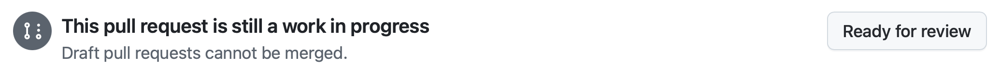

| [← Lección anterior: Gestión de agentes][previous-lesson] |
|:--|

## Revisa el trabajo

Durante este taller has trabajado con GitHub Copilot en varias tareas para mejorar la experiencia de usuario y añadir funcionalidades. Le has pedido que añada documentación al código, cree una función de juegos relacionados para que el equipo de diseño pueda iterar y añada funciones de accesibilidad, incluidos modos de alto contraste y claro. Revisa los cambios de código y, si es necesario, proporciona comentarios a Copilot para que los mejore.

### Escenario

Como se ha destacado en varias ocasiones, los fundamentos del diseño de software y DevOps no cambian al incorporar IA generativa. Siempre debemos revisar el código generado y seguir nuestro proceso habitual de DevOps. Con esto en mente, revisa las sugerencias de GitHub Copilot para crear documentación, añadir la función de juegos relacionados y mejorar la accesibilidad antes de habilitar las revisiones para el resto del equipo.

## Seguridad y agente de GitHub Copilot en la nube

Como el agente de GitHub Copilot en la nube realiza tareas de forma asíncrona y sin supervisión, se han establecido ciertas restricciones de seguridad:

- Copilot solo tiene acceso de lectura al repositorio y acceso de escritura **únicamente** a la rama que utilizará para el código.
- El agente en la nube se ejecuta en GitHub Actions, donde crea un entorno independiente y efímero para trabajar.
- Un usuario debe aprobar cualquier flujo de trabajo de GitHub Actions antes de que se ejecute.
- [El acceso a recursos externos está limitado de forma predeterminada](https://docs.github.com/copilot/how-tos/copilot-on-github/customize-copilot/customize-cloud-agent/customize-the-agent-firewall), incluidos los servidores MCP.

## Revisa la documentación generada

Empieza por explorar la primera solicitud de incorporación de cambios (PR) generada por el agente de GitHub Copilot en la nube: la que añade documentación al código. Para ello, utilizarás la interfaz habitual de PR de GitHub.com.

> [!NOTE]
> Al explorar la PR, quizá veas una advertencia que indica que el firewall ha bloqueado GitHub Copilot. Es **normal**, ya que Copilot tiene acceso limitado a recursos externos de forma predeterminada, incluidas las llamadas a servidores MCP externos. Si quieres, puedes [personalizar o deshabilitar el firewall del agente de GitHub Copilot en la nube][agent-firewall].

1. Vuelve al repositorio en github.com.
2. Selecciona **Pull Requests** para abrir la lista de solicitudes de incorporación de cambios.
3. Abre la PR cuyo título sea parecido a **Add missing documentation** o tenga una descripción más detallada.

> [!NOTE]
> Si Copilot todavía está trabajando en la tarea, la PR incluirá la etiqueta **[WIP]**. Espera a que termine. Puede tardar unos minutos; puedes hacer una pausa o repasar lo que has aprendido hasta ahora.

4. Cuando la PR esté lista, selecciona la pestaña **Files changed** y revisa los cambios.

    

5. Explora el código actualizado, que incluye comentarios de documentación TSDoc recién creados y otra documentación. Los cambios exactos pueden variar.

    Al revisar los cambios, busca comentarios de documentación TSDoc, convenciones de TypeScript y comentarios de cabecera. Proceden de los archivos de instrucciones personalizadas que consultaste al principio del ejercicio 2.

6. Cuando hayas terminado la revisión y todo parezca correcto, vuelve a la pestaña **Conversation** y desplázate hacia abajo.
7. Deberías ver un indicador de que hay flujos de trabajo pendientes de aprobación.
8. Si hay flujos de trabajo pendientes, selecciona **Approve and run workflows**.

   

9. Los flujos de trabajo deberían ponerse en cola en la sección de comprobaciones de la PR. Si todo va bien, las comprobaciones del proyecto para la aplicación Astro deberían superarse. Puede tardar unos minutos.

## Solicita cambios a GitHub Copilot

Trabajar con Copilot en una solicitud de incorporación de cambios no es una interacción unidireccional. Puedes mencionar a Copilot en comentarios de la PR, igual que a otro miembro del equipo, o en comentarios insertados en el código. Copilot leerá esos comentarios e iniciará otra sesión para atenderlos. Como los resultados son no deterministas, no podemos prescribir un texto concreto para la solicitud. Algunas ideas de cambios que puedes pedir a Copilot:

- Añadir comentarios de cabecera al principio de cada archivo de código con una breve descripción de su función.
- Añadir comentarios de documentación TSDoc a los archivos TypeScript y Astro.
- Crear un README que describa la estructura de la aplicación Astro.

1. Añade un comentario para solicitar un cambio en la documentación generada y menciona a **@copilot**, como harías con cualquier usuario. Puedes usar una de las ideas anteriores u otra sugerencia de documentación que quieras incluir en el código base.
2. Selecciona **View Session** para ver cómo Copilot trabaja. Observa cómo inicia una sesión nueva para realizar los cambios.
3. Puedes seleccionar **Back to pull request** para volver a la PR.

    

4. Cuando Copilot termine los cambios, debería aparecer una confirmación nueva en la PR.
5. Selecciona la pestaña **Files changed** para revisar los cambios.

Puedes seguir iterando hasta que estés satisfecho. Cuando lo estés, puedes convertir la PR de borrador a lista para revisión y combinarla en la rama principal.



## Revisa la función de juegos relacionados

Vuelve a la PR que Copilot generó para resolver la incidencia de mostrar juegos relacionados en la página de detalles.

1. Vuelve al repositorio en GitHub.com.
2. Selecciona la pestaña **Pull Requests**.
3. Selecciona la PR cuyo título sea parecido a **Show related games on the game details page** o tenga una descripción más detallada.
4. Selecciona la pestaña **Files changed** para revisar el código generado.
5. Cuando hayas revisado los cambios y todo parezca correcto, vuelve a la pestaña **Conversation** y desplázate hacia abajo.
6. Deberías ver un indicador de que hay flujos de trabajo pendientes de aprobación.
7. Si hay flujos de trabajo pendientes, selecciona **Approve and run workflows**.

   

8. Los flujos de trabajo deberían ponerse en cola en la sección de comprobaciones de la PR. Si todo va bien, las comprobaciones del proyecto para la aplicación Astro deberían superarse. Puede tardar unos minutos.
9. **Opcional:** Puedes cambiar a esta rama en el codespace para probar manualmente la función de juegos relacionados. Ve al codespace, abre el terminal y ejecuta los siguientes comandos (sustituye `<branch-name>` por el nombre de la rama creada por Copilot, por ejemplo, **copilot/fix-8**):

    ```bash
    git fetch origin
    git checkout <branch-name>
    ```

Copilot ha creado la función de juegos relacionados. Como antes, puedes iterar con el agente de GitHub Copilot en la nube para pedir cambios. Por ejemplo, puedes solicitar que ajuste el número de juegos relacionados o que añada comentarios de cabecera y comentarios de documentación TSDoc. Recuerda que esta tarea se asignó **antes** de actualizar las instrucciones personalizadas. Puedes pedir estos cambios añadiendo un comentario en la pestaña **Conversation**; Copilot lo leerá e iniciará otra sesión.

## Revisa las funciones de accesibilidad

Por último, revisa las funciones de accesibilidad implementadas con el agente personalizado de accesibilidad. Esta PR debería incluir tanto el modo de alto contraste asignado en el ejercicio 3 como el modo claro solicitado desde el centro de control en el ejercicio 4.

1. Vuelve al repositorio en GitHub.com.
2. Selecciona la pestaña **Pull Requests**.
3. Selecciona la PR cuyo título sea parecido a **Add high contrast mode to website** o tenga una descripción más detallada.

> [!NOTE]
> Si Copilot sigue trabajando en la tarea, la PR incluirá la etiqueta **[WIP]**. Espera a que termine; puede tardar unos minutos.

4. Selecciona la pestaña **Files changed** para revisar el código generado.
5. Revisa la implementación y presta atención especialmente a:
   - los componentes de interfaz para alternar entre modos.
   - el uso del almacenamiento local para conservar las preferencias del usuario.
   - los cambios de CSS o estilos para los modos de alto contraste y claro.
   - los atributos de accesibilidad, como las etiquetas ARIA y la navegación con teclado.
   - el código JavaScript/TypeScript que gestiona el cambio de modo.

6. Cuando hayas revisado los cambios y todo parezca correcto, vuelve a la pestaña **Conversation** y desplázate hacia abajo.
7. Deberías ver un indicador de que hay flujos de trabajo pendientes de aprobación.
8. Si hay flujos de trabajo pendientes, selecciona **Approve and run workflows**.

   

9. Los flujos de trabajo deberían ponerse en cola en la sección de comprobaciones de la PR. Si todo va bien, las comprobaciones del proyecto para la aplicación Astro deberían superarse. Puede tardar unos minutos.
10. **Opcional:** Puedes cambiar a esta rama en el codespace para probar manualmente las funciones de accesibilidad. Ve al codespace, abre el terminal y ejecuta los siguientes comandos (sustituye `<branch-name>` por el nombre de la rama creada por Copilot):

    ```bash
    git fetch origin
    git checkout <branch-name>
    ```

    Después, inicia la aplicación y prueba los modos de alto contraste y claro en el navegador. Comprueba que funcionan y que las preferencias se conservan al volver a cargar la página.

Observa cómo el agente personalizado de accesibilidad ha ayudado a Copilot a implementar estas funciones siguiendo prácticas recomendadas de accesibilidad. Si detectas problemas o mejoras de accesibilidad, puedes mencionar a **@copilot** en un comentario para solicitar cambios, como hiciste con las otras PR.

## Ejercicio opcional: sigue delegando

El agente en la nube resulta más útil cuando puedes asignarle elementos reales del backlog y ocuparte de otras tareas. Para adquirir este hábito, crea otras incidencias en tu repositorio y asígnaselas a Copilot. Algunas ideas:

- Crear un formulario de interés para promotores en la página de detalles del juego.
- Implementar paginación en la página de lista de juegos.
- Añadir validación de entradas y gestión de errores a los ayudantes de acceso a datos.

## Resumen

Has completado el recorrido del agente en la nube. A lo largo de estas lecciones:

- **Has inspeccionado los archivos de instrucciones personalizadas incluidos en este repositorio** para observar su efecto posterior en el agente en la nube.
- **Has asignado incidencias al agente de GitHub Copilot en la nube** y has observado cómo configura su entorno, planifica y trabaja de forma asíncrona.
- **Has creado y utilizado un agente personalizado** de accesibilidad para añadir modos de alto contraste y claro.
- **Has utilizado la página de agentes de Copilot como centro de control** para supervisar y orientar la sesión de accesibilidad mientras estaba en curso.
- **Has revisado e iterado sobre las solicitudes de incorporación de cambios del agente en la nube**, mencionando a `@copilot` para pedir cambios y aprobando flujos de trabajo.

## Revisión y pasos siguientes

Has completado el recorrido del agente en la nube. Si quieres seguir explorando, los otros recorridos complementan lo que has practicado:

- 🖥️ **[Recorrido de VS Code](../../vscode/)**: explora el modo agente de Copilot Chat y la integración con MCP directamente en el IDE.
- 💻 **[Recorrido de CLI](../../cli/)**: entrega dos cambios revisados desde el terminal con los modos Plan y Autopilot, habilidades de agente, un agente de QA personalizado, Playwright MCP, Agent Merge y un puente opcional `/delegate` al agente en la nube.

En tu propio repositorio, prueba estas ideas:

- Asigna al agente en la nube una incidencia de refactorización o de cobertura de pruebas.
- Crea un agente personalizado para otro ámbito.
- Configura `copilot-setup-steps.yml` para otra pila tecnológica.

## Recursos

- [GitHub Copilot][github-copilot]
- [Acerca de los agentes de Copilot][copilot-agents]
- [Asignar incidencias de GitHub a Copilot][assign-issue]
- [Prácticas recomendadas para el flujo de trabajo de configuración del agente en la nube][cloud-agent-best-practices]
- [Configurar el firewall del agente en la nube][agent-firewall]

---

| [← Lección anterior: Gestión de agentes][previous-lesson] |
|:--|

[github-copilot]: https://github.com/features/copilot
[cloud-agent-overview]: https://docs.github.com/copilot/concepts/agents/cloud-agent/about-cloud-agent
[assign-issue]: https://docs.github.com/copilot/how-tos/use-copilot-agents/cloud-agent/start-copilot-sessions
[setup-workflow]: https://docs.github.com/copilot/how-tos/copilot-on-github/customize-copilot/customize-cloud-agent/customize-the-agent-environment
[copilot-agents]: https://docs.github.com/copilot/concepts/agents/cloud-agent/about-cloud-agent
[cloud-agent-best-practices]: https://docs.github.com/copilot/how-tos/copilot-on-github/customize-copilot/customize-cloud-agent/customize-the-agent-environment
[agent-firewall]: https://docs.github.com/copilot/how-tos/copilot-on-github/customize-copilot/customize-cloud-agent/customize-the-agent-firewall

[previous-lesson]: ../4-managing-agents/
